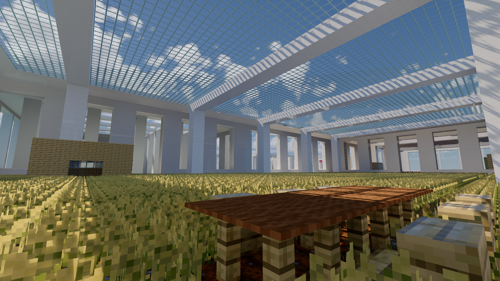

# The Familiar Elsewhere · 似曾之境

**作者 / Author：enxv233**  
Minecraft Java Edition **1.21.1** 池核 / 阈限 / 梦核探索地图。

白色建筑坐落于浅海之上，大小空间、池岸、错层与桥网相互交织，供步行探索。

## 下载与安装

在 [Releases](https://github.com/userenxv/The-Familiar-Elsewhere/releases/latest) 下载 `The-Familiar-Elsewhere-Java-1.21.1.zip`。

解压后，将整个 `The Familiar Elsewhere(似曾之境)` 文件夹放入 Minecraft 实例的 `saves` 目录，然后在单人游戏中打开。

压缩包包含完整存档、Voxy 数据及 LICENSE.txt。发布包来自作者指定的干净版本。

## 协议

**ARR — All Rights Reserved（保留所有权利）**。作者：**enxv233**。

未经作者事先许可，不授予转载、分发、修改或制作衍生作品的许可；适用法律允许的情形除外。详见 [LICENSE.txt](LICENSE.txt)。
